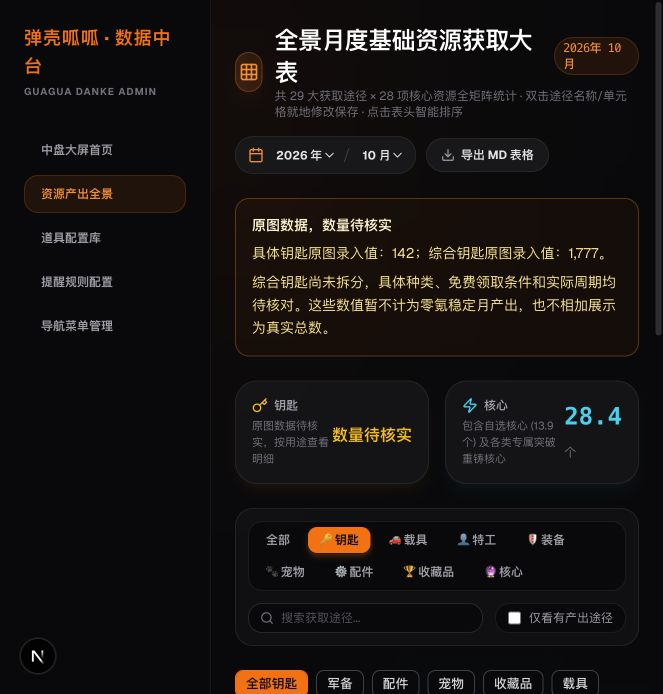
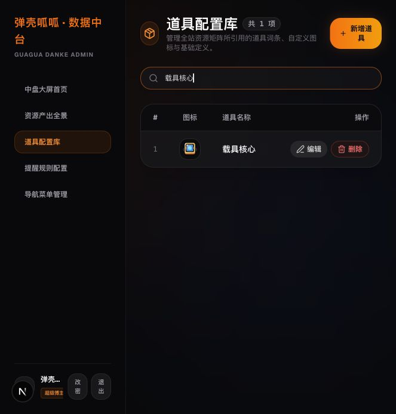

> 2026-10-21 更新：下文是原图核对历史。本次口述规则已另行备份并回填，最新数量、替代记录和待确认项见 [口述回填报告](user-import-report.md) 与 [JSON](user-rules.json)。原图合计不再代表当前十月录入值。

# 钥匙分类与零氪产出核对

## 当前结论

已审查19条综合钥匙和5条载具钥匙，共24条。未发现重复的年月、道具、途径记录；原图综合列的19行合计1777，载具列5行合计142。算术核对通过，不代表真实月产出已核实。

**目前24条均待核实，没有足够的当前版本第一手依据可给出修正值或零氪稳定月产出总数。空值表示未知，不表示0。** 本次没有修改、清零或拆分任何产出数量，也不把1777与142相加为真实总数。

## 分类规则

军备：普通、高级、S级军备钥匙；配件：配件宝箱钥匙；宠物：宠物钥匙、高级宠物箱钥匙；收藏品：收藏品宝箱钥匙；载具：载具零件钥匙。综合钥匙及未知KEY类型道具进入待核实组。

分类只说明用途。即使已分到载具组，142仍然是待核实的原图录入值，不代表已核实数量。

## 核对依据与限制

- [官方入口](https://danke.habby.cn/index.html)：用于确定官方网站，无法从官网取得本表的逐项奖励数据。
- [官方公会玩法说明（2024-05-31）](https://www.taptap.cn/moment/539457529604738420)：官方账号说明分组、公会币兑换机制。年代早于本表，不能据此确认5.3版本的数值、月内次数或免费可领取上限。
- [官方公告目录](https://www.taptap.cn/app/239712/topic?type=official)：截至2026-10-20本次检索，未取得能逐条确认本表24条数据的当前版本官方奖励明细。
- 用户原图：可核对录入值；原图已注明部分资源为平均估计，且未提供逐种类、逐奖励档位和日期的证据。旧4.9导入脚本不作为真实数量证据。非官方攻略、旧版本转载与不相关福利服数据未被采纳。
- agent-reach CLI本机不可用，已改用网页检索进行上述有限核对。

## 逐来源待确认清单

每条记录的单次奖励、实际周期、十月次数、领取条件、奖励性质、依据及建议修正值均保存在[机器可读核对表](key-audit.json)。没有证据的字段保持null，状态PENDING。

| 获取途径 | 原道具列 | 原值 | 图中可识别种类 | 需要的核对依据 |
|---|---|---:|---|---|
| 潮汐秘境 | 其他钥匙（综合） | 60 | 未分种类 | 需核对玩法档位、周期和免费奖励；其载具钥匙28恰为原图总计114与行和142的差值。 |
| 潮汐秘境 | 载具零件钥匙 | 28 | 载具零件钥匙 | 需核对玩法档位、周期和免费奖励；其载具钥匙28恰为原图总计114与行和142的差值。 本条钥匙种类可按图识别为载具零件钥匙，但数量与周期仍未核实。 |
| 工会商店兑换 | 其他钥匙（综合） | 90 | 未分种类 | 需核对钥匙种类、单次价格、兑换上限及免费公会币预算；兑换奖励之间是否争用同一预算。 |
| 工会商店兑换 | 载具零件钥匙 | 30 | 载具零件钥匙 | 需核对钥匙种类、单次价格、兑换上限及免费公会币预算；兑换奖励之间是否争用同一预算。 本条钥匙种类可按图识别为载具零件钥匙，但数量与周期仍未核实。 |
| 工会探索 | 载具零件钥匙 | 24 | 载具零件钥匙 | 需确认具体活动日期、免费任务或兑换档、钥匙种类及与其他四类活动是否互斥；每项60不自动按同月累计。 本条钥匙种类可按图识别为载具零件钥匙，但数量与周期仍未核实。 |
| 工会远征第二阶段 | 其他钥匙（综合） | 240 | 未分种类 | 需确认所属公会档位、钥匙种类、每期奖励和周期，不能将240直接视为稳定月产出。 |
| 工会远征第一阶段难度12以上 | 其他钥匙（综合） | 152 | 未分种类 | 原图限定难度12以上；需确认当前版本档位、钥匙种类、每期奖励及月内结算次数。 |
| 广告 | 其他钥匙（综合） | 135 | 未分种类 | 需核对广告入口、每次奖励种类和数量、每日上限及当月天数；135不可直接等同于单一钥匙。 |
| 活动1（配件） | 其他钥匙（综合） | 60 | 未分种类 | 需确认具体活动日期、免费任务或兑换档、钥匙种类及与其他四类活动是否互斥；每项60不自动按同月累计。 |
| 活动2（武器，载具） | 其他钥匙（综合） | 60 | 未分种类 | 需确认具体活动日期、免费任务或兑换档、钥匙种类及与其他四类活动是否互斥；每项60不自动按同月累计。 |
| 活动2（武器，载具） | 载具零件钥匙 | 30 | 载具零件钥匙 | 需确认具体活动日期、免费任务或兑换档、钥匙种类及与其他四类活动是否互斥；每项60不自动按同月累计。 本条钥匙种类可按图识别为载具零件钥匙，但数量与周期仍未核实。 |
| 活动3（宠物） | 其他钥匙（综合） | 60 | 未分种类 | 需确认具体活动日期、免费任务或兑换档、钥匙种类及与其他四类活动是否互斥；每项60不自动按同月累计。 |
| 活动4（无进度或兑换） | 其他钥匙（综合） | 60 | 未分种类 | 需确认具体活动日期、免费任务或兑换档、钥匙种类及与其他四类活动是否互斥；每项60不自动按同月累计。 |
| 活动5（四合一） | 其他钥匙（综合） | 60 | 未分种类 | 需确认具体活动日期、免费任务或兑换档、钥匙种类及与其他四类活动是否互斥；每项60不自动按同月累计。 |
| 派对/连锁礼包 | 其他钥匙（综合） | 120 | 未分种类 | 需核对免费领取段、付费前置条件、钥匙种类及期次。 |
| 区域 | 其他钥匙（综合） | 48 | 未分种类 | 原图明确标注“待更新”；需确认本期规则、免费领取条件及钥匙种类。 |
| 任务好礼 | 其他钥匙（综合） | 220 | 未分种类 | 需核对免费与付费奖励轨道、任务门槛和每期奖励，220的具体钥匙构成未知。 |
| 试炼之路+永久卡 | 其他钥匙（综合） | 45 | 未分种类 | 两个来源在图中合并；需拆开核对永久卡前置条件及试炼新增层数，区分一次性和周期奖励。 |
| 逃离行动 | 其他钥匙（综合） | 90 | 未分种类 | 需核对免费轨道、通关档位、兑换限制和实际赛季周期。 |
| 逃离行动 | 载具零件钥匙 | 30 | 载具零件钥匙 | 需核对免费轨道、通关档位、兑换限制和实际赛季周期。 本条钥匙种类可按图识别为载具零件钥匙，但数量与周期仍未核实。 |
| 通行证免费 | 其他钥匙（综合） | 95 | 未分种类 | 名称标注免费，但缺少当前版本免费轨道截图、钥匙种类和结算周期。 |
| 限时好礼 | 其他钥匙（综合） | 12 | 未分种类 | 需核对具体礼包期次、免费领取档与付费档，12的钥匙种类和月内次数未知。 |
| 巡逻掉落 | 其他钥匙（综合） | 120 | 未分种类 | 需确认固定奖励与随机掉落、领取次数及额外巡逻条件；随机估计不能计为稳定产出。 |
| 主线+挑战更新，按照5关 | 其他钥匙（综合） | 50 | 未分种类 | 原图口径为更新5关；需确认十月实际更新及通关条件，不能直接视为可每月重复领取。 |

## 数量偏高的排查方向（尚未证实）

1. 军备、宠物、收藏品等不同钥匙混在一列，不能将综合值当作其中一种钥匙数量。
2. 公会档位、关卡更新、试炼进度、兑换预算等条件可能影响实际可领取数量。
3. 五类活动是否都在2026年10月发生、是否可同时累计、兑换是否互斥，均缺实际期次证据。
4. 礼包与通行证的免费/付费轨道需要分开；名称不能替代奖励截图。
5. 广告、巡逻是否有随机产出和额外领取条件需要核实。
6. 载具原图合计114，逐行142，差值正好等于潮汐秘境28。未经确认不能自行删除28或改总数。

## 下一步如何核实和修正

逐条补充当前版本的游戏内奖励说明、领取截图或官方奖励明细，包括钥匙种类、单次数量、周期、免费条件。固定免费、条件奖励、随机奖励、付费奖励分别记录。只有证据清楚且符合已选零氪口径的条目才可进入稳定月产出；不能将待核实条目当作零。

取得依据后先生成具体的前值/后值/证据变更清单，再备份、事务修改并回读验证；没有可靠依据时保留原值。由于本次没有金额或数量变更，本次无需执行产出修正事务。

## 载具核心补图

用户提供的图片已原样保存为后台`/icons/items/载具核心.png`，已更新现有道具图标地址并纳入图标库及载具/核心筛选。道具ID保持不变，产出继续未录入。[原图](vehicle-core-original.png)、[备份及保护记录](preservation.json)。

## 实现与验证结果

- 8种具体钥匙及综合钥匙可在全部钥匙中查看；六类筛选均已用真实后台逐项核验，未知KEY道具归待核实的场景有自动化覆盖。
- 载具核心原图（128×114）加载成功，图标库、道具库、载具和核心分类均已验证。
- 顶部统计使用完整月份数据，不依赖显示列或来源搜索；十月不输出真实钥匙月产出总数。导出钥匙表格时保留待核实说明。
- 前端37项测试通过（完整36项及新增导出核验），TypeScript检查通过，生产静态构建通过；界面机械检查无新发现。
- 所有231条产出（八月104、十月127）及时间戳逐条保持不变，载具核心仍无产出记录，备份详情见 preservation.json。
- 为通过Next.js页面导出约束，将原页面的图标函数和配置移入共享lib，未改API或数据库Schema。

