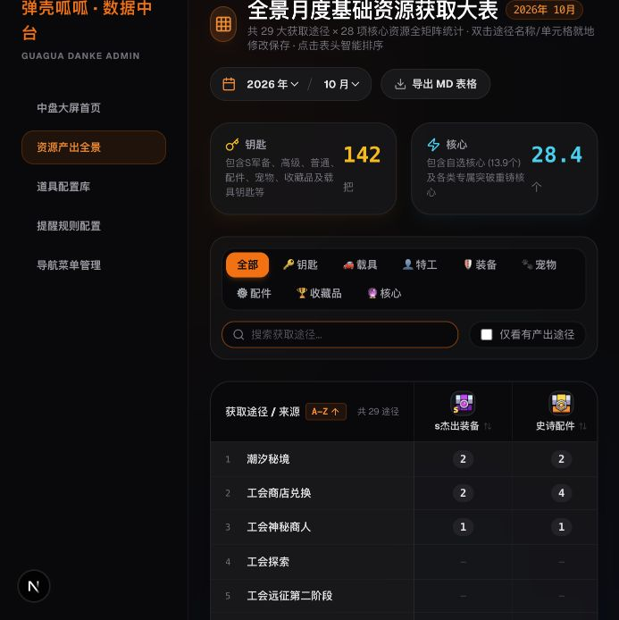

# 2026年10月 · 5.3版本图片资产录入报告

已录入 **20种道具、28个获取途径、127条非空产出**。图片空白未写为零，合计行未作为获取途径导入。用户确认本表归属2026年10月。

## 数据与新增实体

- 新增道具：其他钥匙（综合）（KEY，复用已有其他钥匙图标）、载具核心（CURRENCY，图标和产出暂缺）。
- 已有谐振芯片直接复用；配件核心不另建。第16至19列依次为神器核心、异宠核心、谐振芯片、特工核心。
- 新增途径：派对/连锁礼包、潮汐秘境（EVENT、待分类，实际周期待确认）；主线+挑战更新，按照5关（继承原10关途径的分类和类型）。
- 原按照10关途径保留；区域（待更新）映射已有区域，“待更新”保存在本次产出备注中。
- 数据库现有28种道具、29个途径；十月127条、八月104条产出。总途径数29包含保留的原10关途径，图片实际涉及28个。
- 每条产出备注包含“5.3版本图片统计”和原图途径；原图注明部分数量为平均估计，本次按图记录，不重新推算。

## 待用户决定

1. **载具零件钥匙合计差异**：原图写114，各行相加142。五行分别为工会商店30、工会探索24、逃离行动30、潮汐秘境28、活动2为30。142−114=28。当前保留所有逐格数量（合计142），没有删除潮汐秘境28。
2. **载具核心**：已经建档；没有可靠图标和图中数量，产出保持未录入。图标由现有界面提供占位。
3. **新途径周期及分类**：派对/连锁礼包、潮汐秘境暂归“待分类”，类型暂为EVENT；需确认具体周期。

## 后台现有显示限制

页面顶部“钥匙”卡片与“钥匙”分类采用固定道具名称名单，尚未包含新建“其他钥匙（综合）”。因此十月顶部卡片显示载具零件钥匙142；综合钥匙1777已在“全部”表格对应列、列合计和后端月报中保存。全部钥匙按这两项相加为1919，但本次没有修改前端统计口径。

新增载具核心也尚未加入现有“载具”“核心”分类名单，可在“全部”或道具配置库查看。当前没有该道具的产出记录。

## 校验结果

- 单个事务导入127条；20列逐格回读及合计均通过。
- 数据库副本执行两次，第二次127条均不变，记录ID及时间戳稳定。
- 副本模拟在插入第二个途径产出时失败，所有新增道具、途径和已插入产出全部回滚。
- 八月104条记录逐条保持不变，已有道具与途径字段未修改，其他月份及无关产出受指纹校验保护。
- 真实API返回十月127条、28个参与途径；月报正常。
- 后台刷新后20列合计均通过DOM核对；潮汐秘境、派对礼包和八月/十月切换已实测。

| 原图列 | 道具 | 逐行合计/实际录入 | 原图合计 |
|---|---|---:|---:|
| 1 | s杰出装备 | 28 | 28 |
| 2 | 史诗配件 | 44 | 44 |
| 3 | 杰出配件 | 19 | 19 |
| 4 | 史诗宠物 | 12 | 12 |
| 5 | 杰出宠物 | 15 | 15 |
| 6 | 觉醒水晶 | 110 | 110 |
| 7 | sp特工万能碎片 | 20 | 20 |
| 8 | s特工碎片 | 390 | 390 |
| 9 | 传奇载具碎片 | 25 | 25 |
| 10 | 史诗收藏品 | 43 | 43 |
| 11 | 杰出收藏品 | 13 | 13 |
| 12 | 高级收藏之心 | 40 | 40 |
| 13 | 传奇收藏品 | 8 | 8 |
| 14 | 载具零件钥匙 | 142 | 114 |
| 15 | 其他钥匙（综合） | 1777 | 1777 |
| 16 | 神器核心 | 3.5 | 3.5 |
| 17 | 异宠核心 | 2 | 2 |
| 18 | 谐振芯片 | 4 | 4 |
| 19 | 特工核心 | 5 | 5 |
| 20 | 自选核心 | 13.9 | 13.9 |

## 逐行识别明细

| 行 | 原图获取途径 | 非空数量 |
|---|---|---|
| 1 | 工会远征第一阶段难度12以上 | 史诗配件：20；其他钥匙（综合）：152 |
| 2 | 工会远征第二阶段 | 其他钥匙（综合）：240 |
| 3 | 工会商店兑换 | s杰出装备：2；史诗配件：4；杰出配件：4；史诗宠物：2；杰出宠物：4；觉醒水晶：40；s特工碎片：20；史诗收藏品：4；杰出收藏品：4；传奇收藏品：2；载具零件钥匙：30；其他钥匙（综合）：90 |
| 4 | 工会远征排行榜 | s特工碎片：40；自选核心：2 |
| 5 | 工会探索 | s特工碎片：24；载具零件钥匙：24；自选核心：2 |
| 6 | 通用兑换 | s杰出装备：10；觉醒水晶：30；s特工碎片：70；高级收藏之心：40；传奇收藏品：3；特工核心：2 |
| 7 | 日常挑战 | 神器核心：1.5 |
| 8 | 回响日常部分 | s特工碎片：18 |
| 9 | 回响结算部分 | s特工碎片：30；特工核心：2 |
| 10 | 区域（待更新） | s杰出装备：3；史诗配件：1；杰出配件：5；杰出宠物：3；s特工碎片：25；其他钥匙（综合）：48；自选核心：0.6 |
| 11 | 逃离行动 | s杰出装备：4；史诗配件：4；杰出配件：8；史诗宠物：6；杰出宠物：8；s特工碎片：20；史诗收藏品：4；杰出收藏品：8；载具零件钥匙：30；其他钥匙（综合）：90；神器核心：1；异宠核心：1；谐振芯片：2；特工核心：1 |
| 12 | 试炼之路+永久卡 | 其他钥匙（综合）：45 |
| 13 | 主线+挑战更新，按照5关 | 史诗配件：1；其他钥匙（综合）：50 |
| 14 | 通行证免费 | s特工碎片：3；其他钥匙（综合）：95 |
| 15 | 任务好礼 | s杰出装备：1；史诗配件：1；史诗宠物：1；觉醒水晶：10；s特工碎片：20；其他钥匙（综合）：220；自选核心：0.5 |
| 16 | 限时好礼 | 其他钥匙（综合）：12 |
| 17 | 派对/连锁礼包 | 其他钥匙（综合）：120；自选核心：2 |
| 18 | 联机挑战 | 史诗收藏品：1；传奇收藏品：1；自选核心：2 |
| 19 | 特别行动 | 史诗收藏品：7；自选核心：0.4 |
| 20 | 潮汐秘境 | s杰出装备：2；史诗配件：2；史诗宠物：2；s特工碎片：20；史诗收藏品：2；载具零件钥匙：28；其他钥匙（综合）：60；自选核心：2.4 |
| 21 | 工会神秘商人 | s杰出装备：1；史诗配件：1；杰出配件：1；s特工碎片：10；史诗收藏品：1；杰出收藏品：1；传奇收藏品：1；自选核心：1 |
| 22 | 广告 | 其他钥匙（综合）：135 |
| 23 | 巡逻掉落 | s特工碎片：60；其他钥匙（综合）：120 |
| 24 | 活动1（配件） | s杰出装备：1；史诗配件：4；sp特工万能碎片：5；s特工碎片：10；史诗收藏品：4；传奇收藏品：1；其他钥匙（综合）：60；谐振芯片：1 |
| 25 | 活动2（武器，载具） | s杰出装备：1；史诗配件：1；sp特工万能碎片：5；s特工碎片：10；传奇载具碎片：15；史诗收藏品：6；载具零件钥匙：30；其他钥匙（综合）：60；神器核心：1 |
| 26 | 活动3（宠物） | s杰出装备：1；史诗宠物：1；觉醒水晶：30；sp特工万能碎片：5；s特工碎片：10；史诗收藏品：8；其他钥匙（综合）：60；异宠核心：1 |
| 27 | 活动4（无进度或兑换） | s杰出装备：1；史诗配件：4；杰出配件：1；传奇载具碎片：10；其他钥匙（综合）：60；谐振芯片：1 |
| 28 | 活动5（四合一） | s杰出装备：1；史诗配件：1；sp特工万能碎片：5；史诗收藏品：6；其他钥匙（综合）：60；自选核心：1 |

## 文件及备份

- [原始图片](source.png)、[机器可读识别明细和映射](data.json)。
- [数据库/API验证结果](verification.json)、[页面验证结果](browser-verification.json)、[后台截图](admin-october.png)。
- 导入前已使用SQLite在线备份保存（包含WAL已提交数据）：`/Users/hbt/.local/state/danke-core/import-backups/2026-10-v5.3-1792495158985-363bce71-0e72-4872-9eb0-fb74ad558354.db`。
- 一次性脚本：`scripts/import-2026-10-v5_3.ts`。预检：`npx ts-node scripts/import-2026-10-v5_3.ts`；正式执行增加`--apply`。重复执行会按已确认图片覆盖相同年月、道具、途径的数量；不会清理空白格或其他记录。
- 未运行旧4.9导入脚本，未更改API、Schema或前端源码，未修改用户已有的`scripts/sync-all-to-core.ts`改动。

## 后续补充：载具核心与钥匙核对

载具核心图标已补齐，数量仍待补。用户已指出钥匙种类和数量口径均需核实；上文1919只是一次数学加总，不作为真实或稳定月产出。本次保留原始导入记录作为审计历史，最新结论及24条待核对记录见[后续核对报告](key-review/report.md)。
